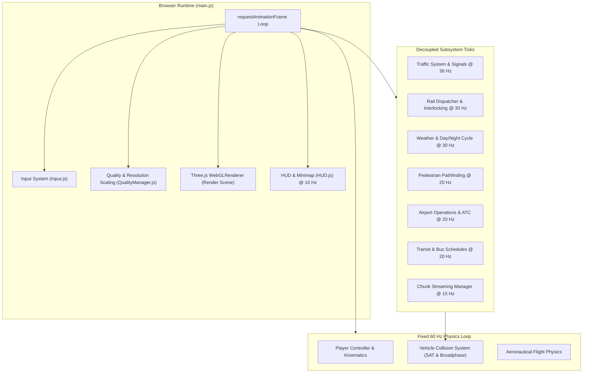
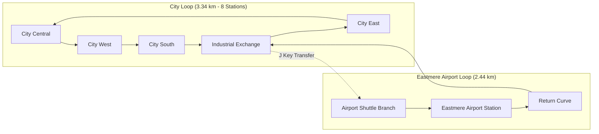
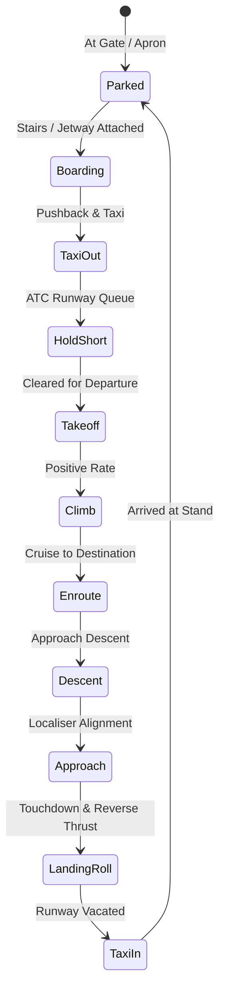

# Blackwater Relay — Urban Systems: How It Works & Architecture Guide

Blackwater Relay (Urban Systems) is a fully featured, procedural, open-world 3D urban and regional transport simulation running directly in modern web browsers using Three.js. It features a complete multimodal transport network including road traffic with UK lane discipline, a dual-loop grade-separated railway with Class 43 High Speed Trains and interlocking block signalling, a regional aviation network with force-based flight simulation and airport operations, scheduled bus transit, intelligent pedestrians, compound convex collision physics, dynamic weather, and exportable telemetry diagnostics.

---

## Table of Contents

1. [Quick Start & Running](#quick-start--running)
2. [Complete Controls Guide](#complete-controls-guide)
3. [System Architecture & Execution Flow](#system-architecture--execution-flow)
4. [World Geography & Spatial Definition](#world-geography--spatial-definition)
5. [Road Network & UK Traffic Conventions](#road-network--uk-traffic-conventions)
6. [Railway Network, Operations & Signalling](#railway-network-operations--signalling)
7. [Regional Aviation & Flight Simulator](#regional-aviation--flight-simulator)
8. [Scheduled Bus Transit](#scheduled-bus-transit)
9. [Pedestrian Simulation](#pedestrian-simulation)
10. [Physics & Collision Architecture](#physics--collision-architecture)
11. [Police, Incidents & Offence System](#police-incidents--offence-system)
12. [Environment, Lighting & Weather](#environment-lighting--weather)
13. [Streaming, Level of Detail & Performance](#streaming-level-of-detail--performance)
14. [Diagnostics, Telemetry & Developer Tools](#diagnostics-telemetry--developer-tools)
15. [Project Structure & Validation Scripts](#project-structure--validation-scripts)

---

## Quick Start & Running

### Prerequisites
- Any modern web browser supporting WebGL2 and ES Modules (Chrome, Edge, Firefox, Safari).
- Python 3 or any static HTTP file server.
- Node.js (optional, required only for running headless regression tests and validation scripts).

### Launching the Simulation
1. Serve the repository folder over HTTP:
   ```powershell
   py -m http.server 8080
   ```
2. Open your browser and navigate to:
   ```text
   http://localhost:8080/
   ```
3. Keep the terminal running while exploring.
4. *Tip:* After updating code, press **Ctrl+F5** to ensure the browser does not reuse cached JavaScript modules.

> [!NOTE]
> All core Three.js dependencies are vendored locally in the `vendor/` directory. No external CDN, bundler, or build step is required to run the game.

---

## Complete Controls Guide

### General & Environment
| Key / Input | Action |
| :--- | :--- |
| **E** | Interact: enter/exit vehicles, board trains, take pilot/passenger seats, alight at stops |
| **Mouse** | Free-look camera while walking, inside train coaches, aboard buses, or flying |
| **C** | Cycle cameras (Chase, Hood, Bumper, Cockpit, Wing, Passenger views) |
| **T** | Cycle weather conditions (Clear &rarr; Overcast &rarr; Rain &rarr; Fog) |
| **N** | Advance simulation clock by one hour |
| **L** | Toggle vehicle headlights |
| **H** | Sound horn / Ring bell to request next bus stop |
| **I** | Trigger a random city incident and dispatch emergency services |

### Car Driving
| Key / Input | Action | Notes |
| :--- | :--- | :--- |
| **W** | Progressive throttle | Acceleration curves naturally with gear ratio |
| **S** | Footbrake / Reverse | Brakes to a stop; reverses once stationary |
| **A / D** | Steering rack | Rate-limited, speed-sensitive self-centring steering |
| **Space** | Handbrake | Induces rear wheel slip without instant spinning |

### Train Operations (Manual HST Driving)
| Key / Input | Action | Notes |
| :--- | :--- | :--- |
| **W** | Power / Throttle | Applies traction to the Class 43 power car |
| **S** | Service brake | Smooth deceleration profile |
| **Space** | Emergency brake | Maximum brake pressure |
| **R** | Reverse direction | Reverses reverser direction when train is stationary |
| **J** | Loop transfer | Requests junction route switch at Industrial Exchange between City and Airport loops |
| **V** | Railway debug | Toggles visual railway operations and signal overlay |

### Aircraft Piloting (Flight Simulation)
| Key / Input | Action | Notes |
| :--- | :--- | :--- |
| **Tab** | Increase throttle | Spools turbofan engines forward |
| **Shift** | Decrease throttle | Reduces engine thrust |
| **W** | Pitch down (Nose down) | Elevators trim aircraft down |
| **S** | Pitch up (Nose up) | Elevators trim aircraft up (climb) |
| **A / D** | Bank / Turn (Roll) | **A** banks left; **D** banks right (coordinated aerodynamic turn) |
| **&larr; / &rarr;** | Yaw / Rudder | Rudder control for crosswinds, crab, and runway steering |
| **Space** | Wheel brakes | Progressive ground wheel braking |
| **R** *(Hold)* | Reverse thrust | Deploys engine thrust reversers (ground roll only) |
| **U** | Passenger stairs | Requests or retracts boarding stairs when parked at apron |
| **Y** | Airbridge / Jetway | Connects or retracts terminal jetway when parked at gate |

### Diagnostics & Overlays
| Key / Input | Action | Notes |
| :--- | :--- | :--- |
| **F8** | Diagnostics recording | Starts clean telemetry session; pressing again downloads session JSON |
| **B** | Collision hitboxes | Displays physical convex Separating Axis Theorem (SAT) hitboxes |
| **G** | Chunk graph | Visualises active, neighbour, and predicted streaming chunks |
| **Diagnostics Tab** | Object boundaries | Displays magenta/yellow envelopes and exports boundary catalogue |

---

## System Architecture & Execution Flow

Blackwater Relay is structured as an event-driven, multi-frequency simulation pipeline coordinated by `src/main.js`. Different subsystems run at decoupled tick rates to maintain a consistent 60 FPS rendering target while executing complex traffic, rail signalling, and physics calculations.



### Update Frequency Breakdown
- **Fixed Physics (60 Hz / 16.6 ms):** Player driving, walking, bicycle-model vehicle steering, flight equations of motion, and dynamic collision resolution.
- **Traffic & Signals (36 Hz / 27.7 ms):** Road vehicle movement, A* routing, gap acceptance, and traffic light phase transitions.
- **Railway & Environment (30 Hz / 33.3 ms):** Rail block occupation, multi-aspect signals, junction interlocking, timetable dispatcher, and day/night sun angles.
- **Pedestrians & Airport (20 Hz / 50.0 ms):** Pedestrian sidewalk navigation, aircraft ground routing, gate assignments, and ATC queue resolution.
- **HUD & UI (10 Hz / 100 ms):** Speedometer, gear display, minimap blips, diagnostics table, and platform departure boards.

---

## World Geography & Spatial Definition

All spatial data, district boundaries, road graphs, station coordinates, bus lines, and aviation zones are defined deterministically in `src/world/WorldDefinition.js`. The world spans an expansive coastal and island geography:

```text
       [ North: Sea & Open Water ]
                  |
 [ Merehaven Island & Airport (MHA) ]
                  |
     ~~~~~~~~ Real Sea Channel ~~~~~~~~
                  |
 [ Marina & Harbour ] ----- [ Waterfront ]
         |                       |
 [ Central Business District ] -- [ City Station ]
         |                       |
 [ Industrial Zone & Junction ] - [ Suburban Sector ]
         |
 [ Eastmere Airport (EAS) & Regional Farmland ]
```

### Key Geographic Regions
1. **Central Business District (CBD):** High-density multi-storey commercial towers, 4-arm signal-controlled junctions, heavy traffic volume, and wide boulevards.
2. **Waterfront & Marina:** Coastal highway, four-arm landscaped roundabout, piers, and animated reflective ocean water with bump mapping.
3. **Industrial Zone:** Low-rise warehouses, logistics depots, railway freight sidings, and the critical **Industrial Exchange** junction connecting the railway loops.
4. **Suburbs & Civic District:** Medium-density residential blocks, local shops, tree-lined avenues, and pedestrian plazas.
5. **Mainland Countryside:** 30 procedural textured agricultural fields, 110 hedgerows, farm buildings, barns, grain silos, and woodland clusters.
6. **Eastmere Airport (EAS):** Full commercial airport with a 2 km runway, parallel taxiways, passenger terminal, active jetway gates, control tower, and railway terminal station.
7. **Merehaven Island & Airport (MHA):** A rural island across open sea featuring an asphalt runway, apron stands, ground passenger terminal, farm tracks, livestock, and coastal terrain.

---

## Road Network & UK Traffic Conventions

The road transport system enforces strict United Kingdom driving standards, governed by `src/road/RoadGraph.js` and `src/systems/TrafficSystem.js`.

### 1. Left-Hand Traffic (LHT) Rule
- `WorldDefinition.js` specifies `trafficSide: "left"`. The road graph rejects any contrary configuration.
- Every road segment creates directional lanes where traffic travels on the left-hand side of the carriageway.
- Spatial lane lookup incorporates heading vectors to ensure vehicles and the player snap to the correct directional lane rather than the opposing carriageway.

### 2. Junction Aprons & Smooth Connectors
- Road strips, curbs, and sidewalks terminate at mathematically calculated **junction mouths** rather than meeting at an abrupt single point.
- Ordinary intersections feature a continuous, convex asphalt apron connecting all road mouths.
- AI vehicles traverse cubic Bézier connector splines between incoming and outgoing lanes, ensuring natural, smooth turns without pivoting.

### 3. Clockwise Roundabouts & Priority
- Roundabouts (such as the 4-arm Waterfront junction at NE) circulate clockwise.
- Vehicles approaching a roundabout yield to traffic already circulating from their right.
- Roundabouts feature raised curbed grass islands, floral plantings, give-way road markings, and approach signs.

### 4. Route-Aware UK Lane Discipline
- **Keep Left Rule:** Normal traffic cruises predominantly in the leftmost (outer) lane.
- **Overtaking:** Vehicles transition to right-hand lanes only to pass slower traffic or to position themselves for upcoming right turns.
- **Spline-to-Spline Transitions:** Lane changes execute along smooth lateral splines while reserving both origin and target lane slots. Left and right indicator lamps flash during manoeuvres.
- **Kerbside Transit:** Buses strictly use the outermost kerbside lane, ensuring bus stops do not block overtaking lanes.

### 5. Signalized Intersections
- High-capacity urban junctions (CBDW, CBD, CBDE, HUB) are controlled by automated traffic lights (`TrafficSignals.js`).
- Signal cycles include Green, Amber, Red, and Red-Amber phases.
- **Emergency Preemption:** Approaching police cars trigger green wave preemption along their approach corridor.

---

## Railway Network, Operations & Signalling

The railway is a comprehensive, grade-separated network operating realistic British Rail rolling stock with high-speed signalling and route interlocking.



### 1. Dual Independent Loops & Grade Separation
- **City Loop (3.34 km):** Double-track mainline serving 8 urban stations with a minimum curve radius exceeding 230 metres.
- **Eastmere Airport Loop (2.44 km):** Connects tangentially at Industrial Exchange, serving Eastmere Airport Terminal Station.
- **100% Grade Separation:** Contains 15 rail-over-road bridges and **zero level crossings**. Road clearance is guaranteed at a minimum of 6.48 metres.

### 2. Fleet: British Rail Class 43 HST & Mark 3 Coaches
- **Locomotives:** Class 43 High Speed Train (HST) diesel power cars featuring iconic aerodynamic noses, split windscreens, roof radiator fans, working headlights/tail lights, and historical unbranded liveries.
- **Coaches:** Mark 3 passenger carriages with 2+2 seating, centre aisles, window tables, overhead luggage racks, vestibules, and illuminated Passenger Information Displays (PID).
- **Usable Gangways & Moving Intercom:** Players can board any stopped train via open platform doors (**E**), walk through coach interiors and flexible gangways while travelling at 160 km/h, and alight at stations.

### 3. Signalling, Interlocking & Safety Blocks
- **Block System (`RailBlockSystem.js`):** The track is divided into 304 signalling blocks with multi-aspect signals (Green, Double-Yellow, Yellow, Red). Movement authority is calculated from full train body reservations rather than single points.
- **Interlocking (`RailInterlocking.js`):** The junction at Industrial Exchange protects transfer movements. Conflicting signals are held at red, and switches cannot shift under a moving train.
- **Station Platform Management (`StationOperations.js`):** 132 m platform stopping markers automatically align every passenger door within the platform envelope. Stations feature footbridges, stairs with collision height, lift towers, and departure boards.

---

## Regional Aviation & Flight Simulator

The aviation system combines airport ground handling and air traffic control with a force-based flight dynamics model (`src/systems/AirportSystem.js`).



### 1. Two-Airport Network
- **Eastmere Airport (EAS):** Main commercial hub featuring a terminal with a telescoping airbridge/jetway, maintenance hangars, apron taxi lines, and radar tower.
- **Merehaven Island Airport (MHA):** Island airfield with runway, apron parking, ground passenger stairs, windsock, and rural surroundings.
- **Fleet of 10 Persistent Aircraft:** 10 unbranded narrow-body airliners (fictional design inspired by public A320 dimensional references) continuously cycle point-to-point between EAS and MHA.

### 2. Flight Dynamics & Aerodynamics
- **Coordinated Banking:** Turns are driven by bank angle (`g * tan(bank) / airspeed`). Rolling right (**D**) initiates a balanced right turn; rolling left (**A**) turns left.
- **Rudder & Yaw:** Rudder keys (**&larr; / &rarr;**) provide fine yaw adjustment for crosswind correction and runway steering.
- **Lift & Drag Polar:** Lift varies with angle of attack (AoA) and airspeed squared ($v^2$). High angles of attack induce aerodynamic drag and produce realistic stalls.
- **Engine Spooling & Reverse Thrust:** Turbofans have rotational inertia and spool realistically. Holding **R** on the ground deploys thrust reversers for rapid deceleration.
- **Brakes & Ground Handling:** Progressive wheel braking via **Space**.

### 3. Fully Detailed Cockpit & Pilot HUD
- **Flight Deck:** Dual Primary Flight Displays (PFD), Navigation Displays (ND), Electronic Centralised Aircraft Monitoring (ECAM), Flight Control Unit (FCU) autopilot glare-shield, dual thrust levers, speedbrake lever, flap handle, rudder pedals, and populated overhead switch panels.
- **Pilot HUD:** Displays calibrated airspeed (knots), barometric altitude (feet), vertical speed (ft/min), pitch attitude ladder, bank angle, AoA indicator, and engine thrust meters.
- **Ground Services:** Deploy or retract passenger stairs (**U**) and terminal jetways (**Y**).

> [!IMPORTANT]
> **Asset Provenance:** The aircraft 3D mesh is entirely procedural code authored specifically for Blackwater Relay from public dimensions and photographic references. No proprietary or third-party 3D model files (GLB, OBJ, FBX) were imported or derived.

---

## Scheduled Bus Transit

The bus transit layer (`src/systems/TransitSystem.js`) operates an authentic urban transit schedule:
- **Directional Kerbside Stops:** Stops are positioned before junctions with painted yellow road bays, glass passenger shelters, timetables, and benches.
- **Passenger Demand & Dwell Time:** Dynamic passenger queues board and alight at stops. Dwell duration scales with passenger counts.
- **Player Passenger Experience:** Press **E** near the front door of a stopped bus to board. Inside, use **Mouse** to look around, **C** to cycle passenger views, and **H** to ring the stop bell. Press **E** to alight at your destination.
- **Traffic Integration:** Trailing AI vehicles detect dwelling buses as stopped obstacles and queue patiently behind them without erratically swerving.

---

## Pedestrian Simulation

Pedestrian behaviour is managed by `src/systems/PedestrianSystem.js`:
- **Articulated Walking Models:** Multi-segment humanoid figures with animated stride cycles, varied clothing palettes, and accessory details.
- **Curved Sidewalk Navigation:** Pedestrians follow sidewalk splines, navigate around street furniture, and respect road edges.
- **Crossings & Station Access:** Pedestrians utilize marked zebra crossings, climb station staircases, cross footbridges, and enter train vestibules.
- **Hazard Awareness:** Pedestrians monitor approaching road vehicles and halt or back away if a vehicle encroaches on their walking path.

---

## Physics & Collision Architecture

Collision detection is handled by `src/vehicles/VehicleHitboxes.js` and `src/systems/VehicleCollisionSystem.js`. Rather than using coarse bounding boxes, it implements high-performance **2D Compound Convex Polygons** evaluated via the **Separating Axis Theorem (SAT)**.

```text
       Saloon Car                  Lorry (Two-Box Compound)
      /\_______/\                       _____________
     /           \        Cab          /             \  Trailer
    |  [Vehicle]  |   [===]====(O)----|   [Freight]   |
     \___________/                    \_____________/
    (8-Point Taper)
```

### 1. Category-Specific Footprints
- **Saloon / Taxi / Van:** 8-point tapered convex hull respecting bonnet and boot profiles.
- **Sports Car:** Low-profile, aggressively tapered wedge shape with a narrow nose.
- **Buses:** Long rounded-corner profile matching the passenger body shell.
- **Lorries:** Two independent linked convex volumes representing the cab and articulated semi-trailer.
- **Trains:** Tapered Class 43 power car noses and exact 14.55-metre Mark 3 coach shells.

### 2. Spatial Indexing Broadphase
- **14-Metre Vehicle Hash:** Filters collision candidates down to immediate neighbours.
- **46-Metre Building Spatial Grid:** Prevents scanning all 225+ static structures every frame.

### 3. Narrowphase Impulse Resolution
- **Separating Axis Theorem (SAT):** Identifies minimum penetration depth and contact normal.
- **Impulse Response:** Applies mass-weighted positional separation, low-restitution elastic impulse, and tangential friction to eliminate unnatural sliding.
- **Lane Memory:** AI vehicles maintain an offset decay vector after a collision, allowing them to smoothly merge back into their lane over time.

---

## Police, Incidents & Offence System

The city simulation includes a dynamic law enforcement system (`src/systems/PoliceSystem.js`, `src/systems/IncidentSystem.js`):
- **Offence Monitoring:** Police units continuously track traffic offences:
  - Excessive speeding above the local road limit.
  - Running red lights at signalised intersections.
  - Causing vehicle-to-vehicle or pedestrian collisions.
- **Wanted Severity & Pursuits:** Violations escalate the player's wanted level. Police cruisers activate flashing blue beacons, sound two-tone sirens, and dynamically route via A* to intercept the player.
- **Consequences:** Apprehension registers financial fines and penalty points on the player's driving record.
- **Manual Incidents:** Pressing **I** generates an emergency event in the city and dispatches emergency responders.

---

## Environment, Lighting & Weather

The environmental engine (`src/systems/WeatherSystem.js`) governs world illumination and atmospheric states:
- **Day/Night Cycle:** The simulation clock progresses continuously (advance manually using **N**). Sun position, atmospheric hemisphere colour, and shadow angles adjust smoothly from dawn to dusk.
- **Dynamic Shadows:** Cascaded directional shadow maps track the player's focus point, optimizing shadow resolution.
- **Weather Presets (Cycle with T):**
  - **Clear:** Bright sunlight, crisp shadows, high visibility.
  - **Overcast:** Soft, diffused ambient lighting and muted reflections.
  - **Rain:** Animated falling raindrops, darkened road surfaces, and reduced vehicle tire grip.
  - **Fog:** Atmospheric exponential fog obscuring distant buildings and landmarks.

---

## Streaming, Level of Detail & Performance

Blackwater Relay renders expansive city, rail, and sea environments seamlessly at 60 FPS using adaptive streaming (`src/world/WorldChunkManager.js`, `src/core/QualityManager.js`).

### 1. Predictive Neighbourhood Chunk Streaming
```text
  [   ] [ C+2 ] [   ]       Ahead Corridor (Predictive Preload)
  [   ] [ C+1 ] [   ]
  [ N ] [  C  ] [ E ]       Cross Neighbourhood: Player Chunk (C) +
  [   ] [  S  ] [   ]                            North, South, East, West
```
- **Local Grid:** The player chunk and its four cardinal neighbours (North, South, East, West) remain fully detailed.
- **Ahead Corridor:** Using velocity, heading, and road connections, two forward chunks are pre-built in background idle budgets (4.5 ms per frame).
- **Graceful Handover:** When crossing chunk boundaries, departing chunks linger for 1.15 seconds to prevent visual pop-in.

### 2. Hierarchical Level of Detail (LOD)
- **High Tier (< 88 m):** Full vehicle models with animated wheels, transparent glass, driver/passenger figures, and detailed interiors.
- **Mid Tier (88 m – 360 m):** Simplified geometries with consolidated draw calls.
- **Outline Tier (> 360 m):** Low-overhead silhouette meshes and merged road/building footprints.

### 3. Graphics Quality Presets
Users can adjust graphics presets in the right-hand panel (**Settings Tab**):
- **Low:** Maximum performance, disabled dynamic shadows, lower pixel ratio.
- **Medium (Recommended):** Balanced shadows, full simulation fidelity, 1.0x native render scaling.
- **High / Ultra:** High-resolution shadow maps (1024–2048px), extended view distances, and enhanced water shader passes.

---

## Diagnostics, Telemetry & Developer Tools

The simulation provides an enterprise-grade diagnostics engine (`src/core/DiagnosticsManager.js`).

### 1. F8 Telemetry Recording & JSON Export
- Press **F8** to start recording a clean diagnostics session (indicated by the red on-screen indicator).
- Press **F8** again to stop recording. The browser will automatically generate and download a comprehensive JSON file named `city-sim-diagnostics-<timestamp>.json`.
- **Recorded Data:** Frame time percentiles, subsystem execution times (traffic, rail, collisions), collision lifecycles, warning/error logs, and renderer draw-call statistics.

### 2. Developer Console API (`globalThis.cityDiagnostics`)
Open the browser developer console (F12) to access diagnostic controls:
```javascript
// Start telemetry recording
cityDiagnostics.start();

// Stop recording and trigger JSON download
cityDiagnostics.stop();

// Export snapshot of current session without stopping
cityDiagnostics.exportCurrentSession();

// Retrieve live summary metrics
cityDiagnostics.getSummary();

// Enable or disable building & structure visual boundary overlays
cityDiagnostics.setObjectBoundaries(true);
```

### 3. Visual Debug Overlays
- **Press B:** Toggles exact 2D collision hitboxes (Cyan = Player, Amber = Traffic, Yellow = Bus, Red = Police/Train Power Car, Orange = Train Coaches).
- **Press G:** Displays the real-time chunk streaming graph (White = Active, Green = Cardinals, Cyan = Forecast).
- **Building Boundaries (Diagnostics Tab):** Renders magenta wireframe prisms for procedural buildings and yellow prisms for station structures.

---

## Project Structure & Validation Scripts

### Key Files & Directories
```text
Blackwater-Relay/
├── index.html                   # HTML entry point, UI overlay, and Three.js canvas
├── styles.css                   # Glassmorphism UI styling, HUD, and panels
├── package.json                 # Scripts and development dependencies
├── README.md                    # Authoritative system documentation
├── vendor/
│   └── three.module.js          # Standalone Three.js library
├── src/
│   ├── main.js                  # Master application lifecycle & game loop
│   ├── config.js                # Global simulation constants & tuning
│   ├── core/                    # Input, Diagnostics, Performance, Quality, Overlays
│   ├── world/                   # WorldDefinition, CityPlan, CityBuilder, Chunks
│   ├── road/                    # RoadGraph, Lane splines, RoadQuality analysis
│   ├── rail/                    # RailSystem, RailNetwork, Blocks, Interlocking, HSTFactory
│   ├── systems/                 # Traffic, Transit, Pedestrians, Police, Airport, Weather
│   ├── vehicles/                # VehicleFactory, VehicleHitboxes, SAT Collision
│   ├── player/                  # PlayerController (walk, drive, fly, ride)
│   └── ui/                      # HUD, Speedometer, Minimap, Platform displays
├── scripts/                     # Headless validation and benchmark runners
└── tests/                       # Browser and Node test suites
```

### Validation & Quality Assurance Commands
The codebase includes dedicated Node.js verification scripts to maintain system stability:

| Command | Purpose |
| :--- | :--- |
| `npm run lint` | Validates syntax, cache tags, whitespace, and ES module imports across all JS files |
| `npm run smoke` | Headless integration smoke test verifying initialisation of roads, trains, aircraft, and traffic |
| `npm run validate:railway` | Validates track geometry, bridge clearances, platform stopping points, and gradients |
| `npm run validate:operations` | Verifies railway block reservation, signal clearing, interlocking, and timetabling |
| `npm run validate:aviation` | Simulates airport fleet cycles, departure queues, and island passenger round-trips |
| `npm run validate:flight` | Validates flight dynamics, aerodynamics, control inputs, and stall behaviours |
| `npm run validate:boundaries` | Verifies building envelopes and checks for road/structure footprint intrusions |
| `npm run benchmark` | Profiles frame execution budgets, garbage collection, and subsystem micro-timings |

---

*Blackwater Relay — Urban Systems is designed for browser-native simulation, pairing deep multimodal transport engineering with accessible, interactive gameplay.*
